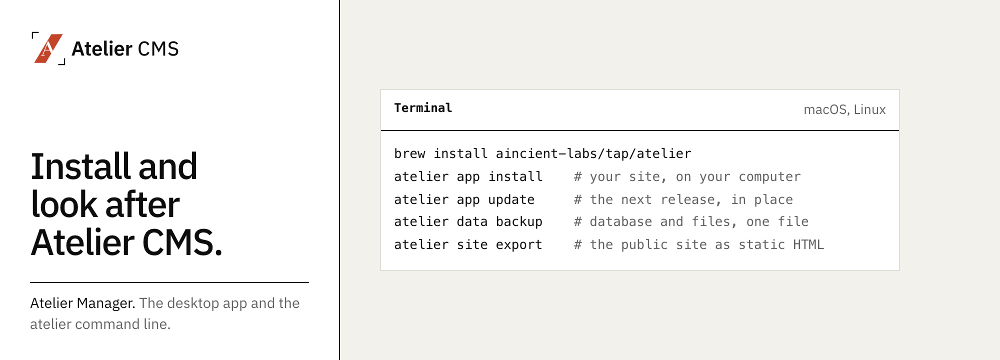

<picture>
  <source media="(prefers-color-scheme: dark)" srcset=".github/readme/hero-dark.png" />
  
</picture>

# Atelier Manager

The installer/manager for an Atelier CMS appliance. One shared Rust engine, two
front-ends:

- **`atelier` CLI** (`crates/aincient-cli`) — the developer/power-user front door,
  distributed via Homebrew and cross-platform installers.
- **Tauri GUI** (`app/`) — a double-click manager for non-technical users. Plain
  HTML/CSS/JS frontend (no bundler) over the same core, via Tauri commands.

Both link **`aincient-core`** (`crates/aincient-core`) directly, so there is exactly one
implementation of every operation and no duplicated logic.

## Why this exists

Install friction is the biggest leak in the evaluator funnel. The real prerequisite floor is
**Docker** (a CMS needs PHP + a database + storage), not the terminal — so the manager is a
*lifecycle manager over the existing appliance*, not a way to skip prerequisites. Every
operation maps to a lower-level primitive the appliance already provides:

Commands are grouped into noun namespaces so the surface stays maintainable as it grows
(`doctor` is the one flat, universal command):

| Command                  | What it does                                                              |
| ------------------------ | ------------------------------------------------------------------------- |
| `app install`            | Lay down `~/.atelier/{compose.yaml,.env}`, pull, `up -d`. Idempotent.     |
| `app update`             | `pull` + `up -d` — `converge.sh` migrates in place and auto-rolls-back. Steps through intermediate versions when one hop can't get there (`--to X.Y.Z`, `-y`). |
| `app check-update`       | Compare the local image digest against the registry tag, and show the route the update would take. (alias `app check`) |
| `app channel [stable\|edge]` | Show or switch which images the install follows. `--now` pulls immediately. |
| `app reinstall`          | Wipe volumes and install fresh (destructive, confirmed).                  |
| `app status`             | Read-only health probe. (The full checkup is the flat `doctor`.)          |
| `app start`/`stop`/`down`/`logs`/`open`/`password` | Everyday stack management.              |
| `site export`            | Export the public site to static HTML — the deploy-anywhere artifact.      |
| `site freeze [--label]`  | Freeze the published site into a snapshot inside the appliance and serve it to visitors; logged-in users keep seeing live. |
| `site snapshots`         | List snapshots (`--json` for machines); ● marks what visitors see.         |
| `site use <id>`/`live`   | Serve a snapshot, or go back to live. Instant; nothing restarts.           |
| `site prune [--keep N]`  | Delete old snapshots; kept and served ones stay.                           |
| `data backup`            | Portable `.tar.gz` snapshot (DB dump + uploaded files + manifest) → `~/.atelier/backups`. (alias `data export`) |
| `data restore <file>`    | Restore a `.tar.gz` snapshot (DB + files, re-chowned) or a legacy `.sql`/`.sql.gz` dump (DB only). (alias `data import`) |
| `data list`              | List snapshots on this host. (alias `data backups`)                       |
| `ai model list`/`set`    | Inspect or bind the AI model per Atelier role.                            |
| `sites list`/`add`/`use`/`rename`/`remove` | Several sites on one machine; `--site <slug>` picks one for any command. See [Several sites](#several-sites). |
| `doctor`                 | Diagnose host + stack + site. `--fix` repairs safely, `--json` for bug reports. |

`export`/`import` alias `data backup`/`restore` so either mental model works; `export` is
never a bare top-level verb (it means one of three things — static site, db+files, db-only —
so it's always qualified by its namespace). The stack directory defaults to `~/.atelier`
(override with `ATELIER_HOME`, or pick a registered site with `--site`) and holds the same `compose.yaml` + `.env` the
`docker/install.sh` bootstrapper writes.

### Several sites

One machine can run several independent sites — each its own appliance with its own containers,
Postgres, files, port and backups. `~/.atelier/sites.toml` lists them and says which one is active
(sites on a server are kept in `~/.atelier/sites.remote.toml`, so an older Manager still reads
`sites.toml`):

```
atelier sites add blog --label "Blog"   # ~/.atelier/sites/blog, first free port, installed
atelier sites list                      # slug, name, port, running, version
atelier sites use blog                  # the active site — what commands use by default
atelier --site blog app status          # any command, against one site
atelier sites rename blog "The Blog"    # the label only; folder and project never change
atelier sites remove blog               # stop + unregister; deletes nothing
atelier app update --all                # every installed site, each on its own route
```

Which site a command acts on: `--site` > `ATELIER_HOME` > the active site > `~/.atelier`. An
existing `~/.atelier` is registered **in place** as `default` the first time the list is changed —
never moved, because its Compose project (and so its data) is keyed off its directory. New sites
pin their project as `atelier-<slug>`. `sites remove` only takes a site off the list: its folder
and volumes stay, and `sites add <slug>` registers it again where it is. `doctor` warns when two
sites are set up on the same port.

### Channels

`AINCIENT_IMAGE` decides everything Docker does, so a "channel" is just a policy about which tag
it names: **stable** = `:latest` (retagged on every release, the default), **edge** = `:edge`
(rebuilt on every merge to main), and anything else — a `:vX.Y.Z` tag, a digest, a local build —
is **pinned** and never moves, so no update can arrive through it.

`.env` also carries `AINCIENT_CHANNEL`, which records the channel the operator *chose* rather than
the one they're on. It exists for exactly one reason: installs made before there were releases
have `:edge` baked into their `.env` because edge was all there was, and they need to be told apart
from an operator who asked for unreleased builds. `install`/`update` move the former onto stable
once (snapshotting first — edge can be *ahead* of the newest release, and Drupal only migrates
forward), announce it, and write the marker so it can never fire twice.

### Stepped upgrades

A release can be unable to migrate arbitrarily old state. The concrete case: the update
that uninstalls a module must run while that module is still in the image, so the release
that finally drops it from `composer.json` can only migrate sites that already ran it.
Every appliance image therefore declares the oldest version it can migrate from, as the
OCI label `dev.atelier.upgrade.min-from` (see `docker/upgrade-floor` in the cms repo).

`app update` reads those labels **straight from the registry, pulling nothing**, walks them
backwards from the target until it reaches a version the install satisfies, and shows the
route before doing anything:

```
$ atelier app update
This upgrade takes more than one step

  from 0.1.1
  1. 0.3.0   (0.4.0 can't migrate a site this old directly)
  2. 0.4.0

Each step pulls its image, migrates, and is health-checked before the next one starts;
a step that fails rolls its own database back. A full snapshot is taken first.

Walk the whole route now? [y/N]:
```

Each hop must finish converging before the next begins — the floor is checked against the
version the site *recorded* on its last successful converge, so running ahead of one would
present the next image with two-versions-ago state and earn its refusal. A hop that doesn't
come up stops the route and says so; the site is left on the last version that converged,
which is a state the appliance guarantees (converge rolls its own database back on failure).
`app check-update` reports the same route, so a long upgrade is visible before it's started.

The manager is the ergonomics, not the safety: the appliance refuses an impossible migration
itself, before touching the database, so a hand-run `docker compose pull` fails safely with a
message naming the version to go through. That also means an unreadable registry or an
unstamped local image costs the *route*, not the safety — the plan falls back to one direct
hop and says why it wasn't verified.

`--to X.Y.Z` stops at a specific version (which leaves the install **pinned** to it —
`app channel stable` resumes following releases). `-y` skips the confirmation.

### `doctor`

`atelier doctor` is read-only and checks three tiers in dependency order, so a failure never
masquerades as the tier below it (a check whose prerequisite failed reports *skipped*, not
*failed*):

| Tier | Checks |
| ---- | ------ |
| **host**  | Docker installed/running, Compose plugin, `buildx` (only the update check needs it) — each reported **with its version**, the CLI and the engine separately since they can differ — plus whether another program has taken the console port, and free disk space. |
| **stack** | `compose.yaml` present and parseable, `.env` still has its `HASH_SALT`, both containers exist, neither is restart-looping or unhealthy. |
| **site**  | Drupal bootstraps, no pending `updatedb`, uploaded-files tree still owned by `www-data`, the image's own `healthcheck.sh` passes, a model role is bound. |

`atelier doctor --fix` climbs a **safe repair ladder**, re-diagnosing after each rung and stopping
the moment nothing is failing — so a site that only needed a cache rebuild never gets a full
self-heal run:

1. restore the stack files (a replaced `compose.yaml` is moved aside, never deleted)
2. `docker compose up -d`, then wait for the console to actually serve
3. `drush cache:rebuild`
4. `drush updatedb -y`
5. `chown -R www-data:www-data` on the files tree
6. re-run the appliance's `converge.sh` — which snapshots the database first and rolls back if
   the repair makes things worse

Every rung's worst case is lost time. **`down -v`, reinstall and restore are excluded at any
flag** — doctor names them as the next step and stops. Exit code is non-zero while anything is
still failing (advisories, like "no model connected yet" on a fresh install, don't count), so it
works as a gate in a script. `--json` emits the whole report plus the verdict and manager version,
for pasting into an issue.

> **v0.2.0 renamed the flat commands into these namespaces** (BC break vs v0.1.0): `install` →
> `app install`, `backup` → `data backup`, `model set` → `ai model set`, and so on. `doctor`
> is unchanged.

### Network calls the Manager makes on its own

On launch, the GUI asks GitHub (`api.github.com`) whether a newer Manager release exists, so it
can show a quiet "get the update" link when this app itself is stale. Nothing about you or your
install is sent — no ID, no version, no OS details, just the request itself — and **we receive no
data**: GitHub doesn't share API request logs with repository owners, so this can't even count
installs. Offline or rate-limited, the check silently does nothing. The Manager never updates
itself; the appliance update banner is about your site, this link is about the app. (The
appliance's own `check-update` talks to the image registry the same way — a version lookup,
nothing more.)

## Develop

```bash
cargo build            # build the workspace
cargo test             # run unit tests
cargo clippy           # lint
cargo run -p atelier -- doctor        # run the CLI
cargo run -p atelier-manager          # launch the GUI
```

The built CLI binary is `target/debug/atelier` (or `target/release/atelier`); the GUI
binary is `target/debug/atelier-manager`. The GUI is packaged into `.dmg`/`.msi`/AppImage
by `cargo tauri build` (in CI, `release-gui.yml`); the macOS bundle is Developer ID signed
and notarized when the Apple secrets are configured (see "macOS code signing" below).

### Scenario tests

Code that changes the owner's Docker (`rm`/`rmi`, `network connect`/`disconnect`, `up`,
`update`, `restart`, file deletes) is tested against real Docker, not parsed output:

```bash
cargo test -p aincient-core --test scenarios -- --ignored --test-threads=1
```

They are `#[ignore]`d (plain `cargo test` skips them), need a running Docker with the compose
plugin, and take about thirteen minutes together (28 scenarios, 29 tests, 765 s on OrbStack; 15–60 s each); CI runs them on Linux (`check.yml`,
job `scenarios`). The harness (`crates/aincient-core/tests/scenarios/harness.rs`):

- writes a site the way the Manager does (`compose.yaml`, `edge.conf`, `.env`, `site-id`) in a
  temp dir: the shipped template with `postgres:16-alpine` as `db`, a small Alpine `app` built per
  test that waits for `db` by name, prints converge's own lines (or, on a flag in its `private`
  volume, a FATAL or an allocation past a memory limit the test sets) and serves `/user/login`, and the shipped `edge` on a free port. Its `drush`
  does only the four calls the Manager's backup/restore scripts make, on the real database, so
  real backups and restores run. Tests then call the real `ops`/`doctor`/`cleanup` functions.
- gives the Manager a temp user home for the whole run, so `~/.atelier/sites.toml` (which
  clean-up reads) is the scenario's own, never yours.
- only ever addresses compose projects named `atelier-scn-<test>-<pid>-<n>`, and refuses any other.
- cleans up when the test ends, passed or failed: `compose down -v`, then every image tag and
  image the test built. Images it did not build are never touched; a scenario whose update would
  run the automatic clean-up refuses to run if that clean-up would remove anything here.
- **on a failed scenario**, prints before tearing down (to the test's output, so a CI log alone
  says why), between `===== scenario site <project>: state before teardown =====` markers:
  `docker compose ps -a`, each container's `State` + restart count (never `Config`/`Env`), and
  its last 200 log lines with Docker's timestamps, stdout and stderr merged by time.
- **`ATELIER_SCN_KEEP=1`**: a failed scenario's site is left running instead, with the commands to
  look at it (`docker compose -p <project> ps -a` / `logs` in its temp dir) and to remove it by
  hand (`docker compose -p <project> down -v`, `docker image rm <its tags and images>`,
  `rm -rf <its temp dir>`). Its dir gets a `.scn-kept` file; later runs leave it alone until
  that file is gone.
- **cleans up after a killed run** (SIGKILL, a CI cancel: `Drop` never runs). Every container
  (an overlay's `labels:`) and image (`docker build --label`) carries `atelier.scn.pid=<test
  process pid>`, and the first harness call of a run sweeps `atelier-scn-*` projects, images and
  temp dirs whose owning process is gone (`sweep_dead_runs`; the decision is the pure
  `sweepable`, unit-tested in plain `cargo test`). A live run's projects (parallel runs) and
  anything not `atelier-scn-*` are never touched. CI also has an `if: always()` step that removes
  every `atelier-scn-*` leftover after the scenarios job.

| Scenario | File | What it holds |
|---|---|---|
| 1 | `stale_endpoint.rs` | Start recovers a db the stale-endpoint clear left on no network; every network kept |
| 2 | `detached_db.rs` | checkup names a detached db; Start reconnects it |
| 3 | `shared_tag.rs` | Start after a shared tag moved keeps the site's image |
| 4 | `settings_applied.rs` | changed `.env`, same image: Update recreates without a backup, then is up to date |
| 5 | `restore_safety.rs` | unwritable backups folder: restore refused, database untouched; `no_safety_backup` restores |
| 6 | `update_stopped.rs` | stopped site that won't boot: update refused (`BackupBeforeUpdateFailed`); `no_backup` updates |
| 6b | `update_running_backup_fails.rs` | running site whose before-update backup fails (read-only backups folder): update refused, site on its build; `no_backup` updates |
| 7 | `cleanup_needed.rs` | a stopped site's image, a digest pin and an engine pin count as needed (selection only) |
| 8 | `erased_db.rs` | erased db volume: Start and `doctor --fix` refuse, create nothing; a restore brings it back |
| 9 | `boot_fatal.rs` | a FATAL boot fails Start in plain words; a later `converge OK` clears it |
| 10 | `prune_backups.rs` | a restore keeps the 3 newest counted automatic backups, never a pre-0.17 one |
| 11 | `oom_app.rs` | app PID 1 OOM-killed during converge (`mem_limit` = `memswap_limit`, shipped restart policy): Start fails "ran out of memory … (the app)", container restarting |
| 11b | `oom_app.rs` | a child in the app OOM-killed, PID 1 lives: Start fails out of memory; container running with `OOMKilled` |
| 12 | `oom_db.rs` | a Postgres backend OOM-killed during boot: Start names the database and says the data is safe; db running |
| 13 | `disk_full.rs` | the backup's dump fills a 1 MB tmpfs `/tmp`: update refused (`BackupBeforeUpdateFailed`) saying Docker's disk is full |
| 14 | `update_blocked.rs` | db running on no network: update refused before any work (`UpdateBlocked`, names the container), nothing reconnected; after Start, it updates |
| 15 | `update_blocked.rs` | app crash-looping out of memory: update refused with the memory text, nothing changed |
| 16 | `update_blocked.rs` | db data volume on a 96 MB tmpfs (Docker's disk as the probe reads it): update refused naming Docker's disk; checkup fails `host.docker_disk` |
| 17 | `site_busy.rs` | an update holds the site (slow boot, on another thread): a restore and a start asked meanwhile are refused (`SiteBusy`, "an update started …"); after it ends, start, backup and restore run |
| 17b | `site_busy.rs` | another process takes the site's lock and is killed: its lock went with it, the next start runs |
| 18 | `update_failed_logs.rs` | a failed update (`no_backup`, converge FATAL) saves `logs/update-*.log` with compose ps, each service's State and timestamped logs incl. the FATAL; the error names it; no `DB_PASSWORD` value, no env |
| 19 | `reconnect_restart.rs` | db of a running site on no network: Start reconnects it **and restarts the app** (new `StartedAt`, same container), Ready, app reaches `db` |
| 20 | `container_gone.rs` | a stopped site's db, then edge, container removed, the shared tag moved: Start creates only that one (`up -d --no-recreate`); the others keep their containers, app its image, db its data |
| 21 | `doctor_start.rs` | edge removed, app stopped, the shared tag moved: `doctor --fix` StartContainers creates edge, starts app in place on its image; no Scaffold rewrite (compose.yaml is the template, the scenario db comes from an overlay) |
| 22 | `endpoint_clear.rs` | a step fails while db (paused: the one not-running state a network still lists) holds endpoints on two networks: Start force-disconnects and reconnects it under `db` on both, retries, then says restart Docker (`NeedsDockerRestart`); after unpause Start is Ready with the data |
| 23 | `db_image_move.rs` | the db image move through `ops::update_with`, between two scenario Postgres builds (feature `scenario-seams`), the new one served by a local `registry:2`: download fails → Ready, compose.yaml untouched; pushed → the next update pulls, rewrites compose.yaml, recreates db + app, data kept |
| 24 | `older_backups.rs` | Free up space's older automatic backups: only the ticked older ones removed; an unticked older one, counted ones and the owner's backup stay even when named in the list |
| 25 | `app_down.rs` | `app down` keeps the volumes and the next Start recreates the containers on the same data; `down --wipe` writes the marker, removes every volume, and the next Start sets up a fresh site and clears the marker |

**Guard: every changing call names its scenario** (`crates/aincient-core/tests/docker_guard.rs`,
runs in plain `cargo test`). It scans `crates/*/src` (not test code) for calls that change the
owner's Docker (a `docker`/`compose` argument list with `rm`, `rmi`, `up`, `down`, `update`,
`restart`, `start`, `stop`, `kill`, `tag`, `pull`, `prune`, `network connect|disconnect`, `cp`
into a container, or a runtime restart) or delete/overwrite files in `aincient-core`
(`remove_file`, `remove_dir_all`, `fs::write`, `fs::rename`, `write_atomic`, …). Each must carry,
on its statement or in the comment lines directly above:

```rust
// scenario: start_reconnects_a_db_the_stale_endpoint_clear_left_without_networks
// scenario: none — <why no scenario covers it yet>
```

A named scenario must be a `#[test]` fn in `tests/scenarios/`. `none` must also be listed, with
its reason, in `crates/aincient-core/tests/docker_guard_allow.txt` (`<path> | <fn> | <what> |
<reason>`): that file is the backlog of changing calls no scenario covers. A new unannotated
call, a name that is no test, an unlisted `none`, or a stale allowlist line fails the build. The
scanner reads string literals, so it can't see command words built at run time or a script
run inside a container; the file's header lists its limits. To list every call it finds:
`ATELIER_GUARD_LIST=1 cargo test -p aincient-core --test docker_guard -- --exact list --nocapture`.

**Seams.** The one place a scenario can't use the product's real names is the database server
move (its images are the real `pgvector/pgvector` tags, which a scenario never pulls or tags):
the crate's feature `scenario-seams` (`stack::scenario_seams`, turned on only for its own tests by
a dev-dependency on itself; the CLI and app never have it) lets scenario 23 stand two
`atelier-scn-` images in for that pair. Everything else runs as shipped. A scenario that runs
`doctor --fix` writes compose.yaml as the template and the scenario db in an overlay
(`Site::db_image_by_overlay`), or the checkup's Scaffold rewrite would put the real db image back.

Adding one: one scenario per incident or regression, in its own file under
`tests/scenarios/`. Build the state the real site was in with Docker's own commands, call the
Manager's function, and assert the end state the owner needs (running, reachable, same image).
Before committing, check it out on the commit before the fix (`git worktree add`) and show it
fails there.

### State zoo

The scenarios run tiny stand-in sites; the zoo makes **real** Atelier sites (the real
`atelier-cms` image, real Drupal) on your own computer, in the states real sites end up in, so a
live check before a release runs the branch's CLI against all of them (DECISIONS 0528). Local
only: it is what covers OrbStack / Docker Desktop, which CI can't.

```bash
scripts/state-zoo.sh up [state…]          # all states, or just these
scripts/state-zoo.sh status               # the zoo sites and their containers
scripts/state-zoo.sh check app start      # any CLI command, against every zoo site
scripts/state-zoo.sh check doctor
scripts/state-zoo.sh check app update --yes
scripts/state-zoo.sh down                 # remove every zoo site completely
```

`check` prints one row per state (state, exit code, the output's last line, time) and keeps
each full output in `zoo-logs/<state>-<command>.log` (gitignored). It always runs
`target/debug/atelier` (built first), never the `atelier` on your PATH.

A changing check consumes the state it ran on (`app start` reconnects `detached-db` and starts
`stopped`), so run read-only checks (`doctor`) first, or remake one state with
`down <state>` + `up <state>` and check only it with `ZOO_ONLY="<state> …"`.

| State (site `zoo-…`) | How it is made | The real history it imitates |
|---|---|---|
| `old-template` | installed, stopped, then `compose.yaml` and `edge.conf` replaced by the last superseded shipped templates (`templates/compose-0.14.1.yaml`, `edge-0.14.0.conf`) and the containers recreated from them with `docker compose up -d` | a site installed by Manager ≤ 0.14.1: db has no restart policy, files the next start/update refreshes |
| `shared-tag-a` | installed, `.env` pointed at the zoo tag `atelier-cms:zoo-shared` (tagged from the local `:latest` image ID) and recreated on it; left running | two sites on one tag; this one was running when the tag moved |
| `shared-tag-b` | same, then stopped; after that the tag is moved to another local `atelier-cms` image (if there is one; the script says so if not) | the 0.17.0 A1 case: a stopped site whose tag moved under it (another site's update) — Start must keep its image |
| `engine-resting` | `engine enable --experimental`, then `site rest --yes --experimental` | a site with the EXPERIMENTAL engine, resting. **Skipped** unless a local `atelier-engine:dev` exists (a developer build pins it; build it with `engine/build.sh` yourself — the zoo makes no image outside `atelier-cms:zoo-*`) |
| `stopped` | installed, `app stop --yes` | a site you stopped and came back to |
| `detached-db` | installed, stopped, `docker network disconnect -f` on db, `docker start` db | the review-tmp incident: db running with no network in its own settings |
| `ro-backups` | installed, one `data backup`, then `chmod 0555 backups/` | a backups folder that lost write permission (copied as another user, read-only mount) |
| `digest-pinned` | installed, then `app install --image ghcr.io/aincient-labs/atelier-cms@sha256:…` (the local image's registry digest) | an owner who pinned an exact build |
| `restored-elsewhere` | installed, then `data restore --other-site --yes` of a backup of another running zoo site (a temporary `zoo-donor` when none runs) | a site restored from another site's / machine's backup (site-id mismatch path) |

**Cost.** About 40 s per site to install (OrbStack, image already here); ≈ 400 MiB RAM and
≈ 300 MiB of Docker disk each, so ≈ 3.5 GiB / 2.7 GiB for the whole zoo. `up` prints the estimate
first and refuses when Docker's disk (read inside a container, as the checkup does) or this
computer's has less than 5 GiB free, or Docker's free memory (total minus what runs now) can't
hold the sites; `up <state…>` makes a subset.

**Rails.** The script only ever addresses sites `zoo-*`, projects/containers/volumes/networks
`atelier-zoo-*` and image tags `atelier-cms:zoo-*`, and refuses the known owner sites by name;
every CLI call passes `--site zoo-…`, and the active site is put back if anything changed it. It
never prunes, never starts or restarts Docker, and never retags `ghcr.io/…:latest`. The Manager's
own install/update pulls run, so `up` and `check` first compare the registry's `:latest` with
the local image and refuse if it would download a new one — pass `--pull` to allow that.

**Cleanup.** `down` runs `app down --wipe --yes` and `sites remove` per site, removes anything
still labelled with its compose project, deletes `~/.atelier/sites/zoo-*`, and untags
`atelier-cms:zoo-*` (the images under them stay: they are the ones already here).

## Release / distribution

**One tag ships everything.** CLI and GUI share the workspace version and ride the **same `v*`
tag**, so they can never drift apart:

```bash
git tag v0.2.2 && git push origin v0.2.2
```

That fans out to two workflows on the one tag:

- **`release.yml`** (cargo-dist, driven by `dist-workspace.toml`) builds the `atelier` CLI for
  every target, creates the GitHub Release, and publishes the Homebrew formula
  (`Formula/atelier.rb`) to `aincient-labs/homebrew-tap` so `brew install aincient-labs/tap/atelier`
  works.
- **`release-gui.yml`** (`tauri-apps/tauri-action`) builds the desktop bundles
  (`.dmg`/`.msi`/`.AppImage`/`.deb`/`.rpm`) — which cargo-dist can't produce — and uploads them
  onto the *same* release cargo-dist creates for that tag.

Keep `app/tauri.conf.json`'s `version` in lockstep with the workspace `Cargo.toml` version when
bumping (the GUI release name is derived from it).

**Homebrew-tap prerequisite:** the cross-repo formula push needs a `HOMEBREW_TAP_TOKEN` Actions
secret — a token with `Contents: read and write` on `aincient-labs/homebrew-tap` (the built-in
`GITHUB_TOKEN` can't push to another repo). Note the **`aincient-labs` org rejects fine-grained
PATs whose lifetime exceeds 366 days** — if `publish-homebrew-formula` fails at the tap checkout,
rotate the secret to a ≤366-day token. (Recovery when it fails: the formula is also attached to
the release as `atelier.rb`, so it can be pushed to the tap by hand.)

### macOS code signing

The macOS bundle is signed with a **Developer ID Application** certificate and **notarized** via the
App Store Connect API. `release-gui.yml` does this automatically **when the secrets below are set**;
with them absent the build falls back to an unsigned bundle (Gatekeeper warns on first launch), so the
workflow is safe to run either way. Windows Authenticode is still a fast-follow.

One-time Apple-side setup (all from [developer.apple.com](https://developer.apple.com/account)):

1. **Certificate** — create a *Developer ID Application* certificate, then export it from Keychain
   Access as a `.p12` (with a password). Base64 it for the secret:
   `base64 -i cert.p12 | pbcopy`.
2. **Signing identity** — the cert's full name, e.g.
   `Developer ID Application: Your Name (TEAMID)` (copy from Keychain Access or `security find-identity -v -p codesigning`).
3. **Notarization key** — App Store Connect → Users and Access → Integrations → App Store Connect API
   → generate a key with the **Developer** role. Download the `.p8` (one-time download), and note the
   **Key ID** and **Issuer ID**. Base64 it for the secret: `base64 -i AuthKey_XXXX.p8 | pbcopy`.

Then add these repo Actions secrets (Settings → Secrets and variables → Actions):

| Secret | Value |
| --- | --- |
| `APPLE_CERTIFICATE` | base64 of the `.p12` |
| `APPLE_CERTIFICATE_PASSWORD` | password you set when exporting the `.p12` |
| `APPLE_SIGNING_IDENTITY` | `Developer ID Application: … (TEAMID)` |
| `APPLE_API_ISSUER` | Issuer ID (UUID) from App Store Connect |
| `APPLE_API_KEY` | Key ID (e.g. `XXXXXXXXXX`) |
| `APPLE_API_KEY_BASE64` | base64 of the `.p8` key (workflow decodes it to a file) |
| `KEYCHAIN_PASSWORD` | *(optional)* any string; auto-generated if unset |
